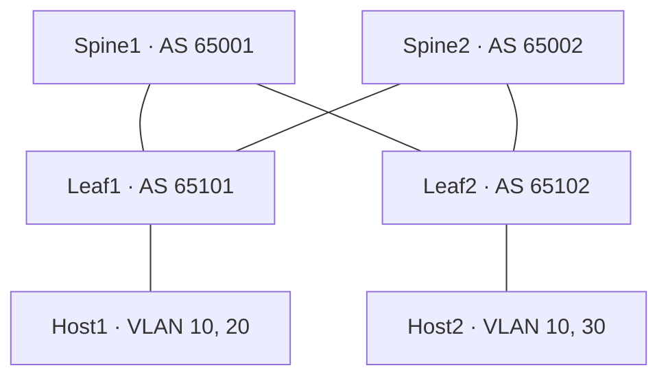

# IDC Network Operations & Resilience Lab

금융권 IDC의 네트워크 운영 판단을 연습한다. [BGP/ECMP](../../../01-bgp-ecmp/README.md), [EVPN/VXLAN](../../../02-evpn-vxlan/README.md), [Digital Twin](../../../10-network-digital-twin/README.md)의 가상 패브릭을 이어서 정상 경로, 링크·제어면 장애, 서비스 영향과 원복을 검증한다.

## 패브릭

| 연결 | A측 포트와 주소 | B측 포트와 주소 |
|---|---|---|
| U1 | Spine1 eth1 · 203.0.113.0/31 | Leaf1 eth1 · 203.0.113.1/31 |
| U2 | Spine1 eth2 · 203.0.113.2/31 | Leaf2 eth1 · 203.0.113.3/31 |
| U3 | Spine2 eth1 · 203.0.113.4/31 | Leaf1 eth2 · 203.0.113.5/31 |
| U4 | Spine2 eth2 · 203.0.113.6/31 | Leaf2 eth2 · 203.0.113.7/31 |
| H1 | Leaf1 eth3 · VLAN 10, 20 | Host1 eth1 · VLAN 10, 20 |
| H2 | Leaf2 eth3 · VLAN 10, 30 | Host2 eth1 · VLAN 10, 30 |

EOS 패브릭 포트는 같은 번호의 Ethernet 포트다. 루프백은 Spine1/2의 `192.0.2.1/32`·`192.0.2.2/32`와 Leaf1/2의 `192.0.2.11/32`·`192.0.2.12/32`다. 언더레이 eBGP는 루프백 /32만 교환하고 양쪽 Spine으로 ECMP를 설치한다. 루프백 간 멀티홉 eBGP는 EVPN만 운반한다. Spine은 VTEP next hop을 보존한다.

| VLAN | VNI | 프리픽스 | VRF와 전달 |
|---|---:|---|---|
| 10 | 1010 | 198.51.100.0/26 | TENANT, 양쪽 Leaf, Type 2·3, 게이트웨이 .1 |
| 20 | 1020 | 198.51.100.64/26 | TENANT, Leaf1 로컬, 게이트웨이 .65 |
| 30 | 1030 | 198.51.100.128/26 | TENANT, Leaf2 로컬, 게이트웨이 .129 |
| IP-VRF | 50000 | VLAN 20·30의 /26 교환 | TENANT, Type 5, RT 65000:50000 |

Host2의 `/healthz`를 VLAN 10 L2와 VLAN 20→30 L3 경로에서 확인한다. Host2는 Leaf2에 단일 연결된다. 패브릭 MTU는 1600이고 Host의 IPv4 MTU는 1500이다. [토폴로지 원본](topology.json)에서 설정과 인벤토리를 생성한다.

## 운영 의존성

| 역할 랩 | 이 시나리오의 담당과 입력 |
|---|---|
| Network Fabric | 토폴로지, FRR·EOS 구성, 정상 BGP·FIB·VNI·HTTP 기준선, NetBox 장비·회선 |
| [Observability & SRE](../../05-observability-sre/idc/README.md) | 기준선과 장애 이벤트 → Prometheus·Loki → Grafana와 로컬 알림 |
| [Change Automation](../../06-change-automation/idc/README.md) | VTY 읽기, Ansible 백업, 정책 후보의 전후 비교 및 원복 |
| [Recovery & DR](../../07-recovery-dr/idc/README.md) | 다섯 장애에서 FIB·ICMP·HTTP·FRR 로그 수집과 복구 보고서 |

서비스가 멈추면 Host2부터 트렁크·VRF·원격 VTEP·Underlay FIB까지 역으로 대조한다. 링크·이웃이 살아 있는 경우 수신 정책과 실제 FIB를 확인한다. 스크레이프 오류는 인터페이스 Down이나 패킷 손실과 별도 상태로 기록한다.

## 출처와 재현 범위

DATA CENTER KOREA 2026의 공식 전시 개요와 프로그램에서 확인한 DCIM·관제·운영 자동화 주제를 적용했다. 링크·정책·복구 시나리오와 측정값은 이 가상 실습에서 얻는다. [공식 전시 개요](https://datacenterkorea.kr/exhibtion/introduce/) · [공식 프로그램](https://datacenterkorea.kr/conference-overview/)

패브릭 주소는 RFC 5737 문서용 대역이고 외부 회선은 합성 원장에만 등록한다. [운영 랩 아키텍처](docs/architecture.md)
