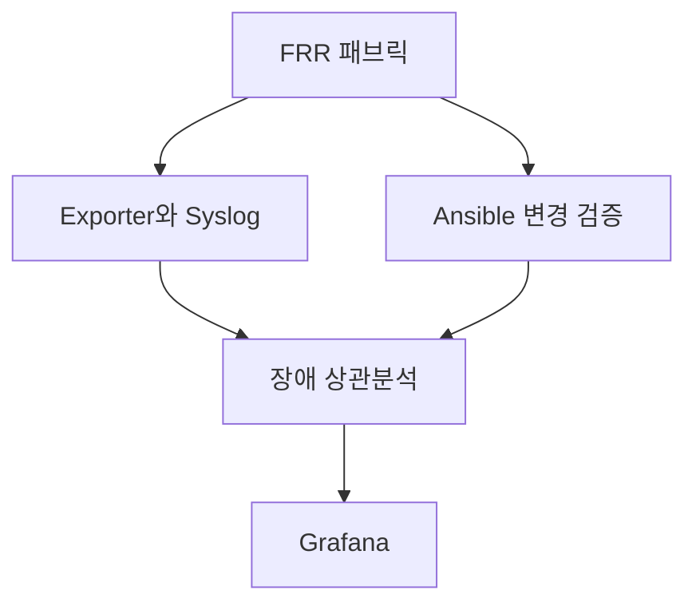

# IDC 운영 랩 아키텍처

격리 Debian VM 안에서 네트워크와 관제 환경을 나눕니다. FRRouting과 Linux Host는 6개의 네임스페이스를 사용합니다. 관제와 자동화는 기본 네임스페이스의 루프백과 FRR 전용 VTY 소켓을 사용합니다. [토폴로지와 주소표](../architecture.md#패브릭) · [토폴로지 원본](../topology.json)

| 구분 | 저장소 자산과 적용 |
|---|---|
| 재사용 | Network Fabric의 eBGP·ECMP·EVPN/VXLAN, 상태 검증과 토폴로지 JSON |
| 재사용 | Observability의 Prometheus·Alertmanager·Alloy/Loki·Grafana Compose와 Exporter |
| 재사용 | Change Automation의 Ansible 인벤토리와 FRR 정책 명령, Recovery의 장애 주입·계측 |
| 수정 | Exporter의 포트·BGP 전이 기록, 실행 중인 패브릭과 복구 증적을 연결하는 ID |
| 구현 | 시간·링크 기반 사건 판정, JSON·Markdown 보고서, Grafana 사건 집계, Ansible 적용 후 Python 사후 검증과 수동 복구 |
| 후속 검토 | Cisco·EOS 수집 어댑터, 공통 Leaf 장애 집계, 장기 증적 보존, Kubernetes 배포 |

`topology.json`이 실습 원장입니다. 별도 NetBox가 준비된 환경에서는 기존 인벤토리 등록 기능을 사용할 수 있습니다. 변경 전후와 사건 보고서는 로컬 파일로 저장하고, Grafana는 기존 Loki와 Prometheus를 조회합니다. [기존 인벤토리 가이드](../README.md#netbox-45-인벤토리)
